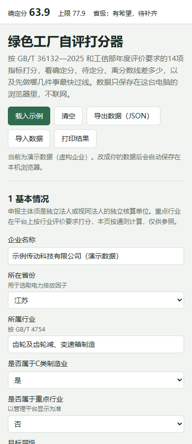
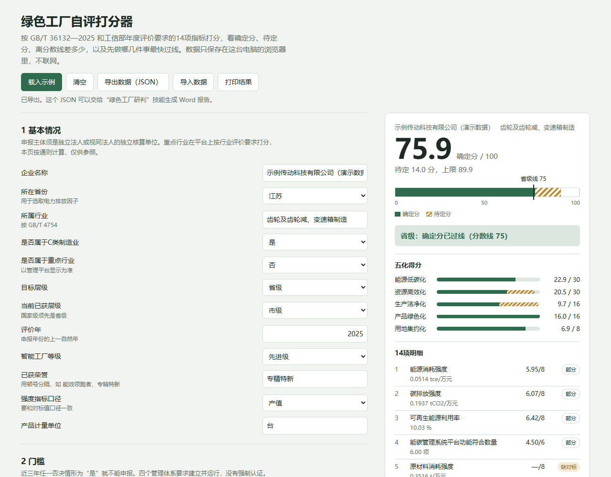

# 悠米一下 · 绿色工厂项目申报

> 按 GB/T 36132—2025 的 14 项指标给企业算分，告诉你**差几分、先做什么、什么时候报**。

[](CHANGELOG.md)
[](scripts/gf_engine.py)
[](#依赖)
[](LICENSE)
[](#时效)

一个用于**绿色工厂（市级 / 省级 / 国家级）研判与申报**的 AI 技能（Skill）。

绿色工厂的评价规则是公开的，企业真正卡住的从来不是"规则是什么"，而是三件事：
**我的数算得对不对、我够不够线、我该先干哪一件。**

这个技能把这三件事变成可以算的东西。

---

## 它到底能干什么

- 按 14 项指标算分，缺数据的标「待定」，**不替你估**
- 给出确定分 / 待定分 / 上限，以及和目标分数线的差距
- 排出**最快过线路径**：每一步加几分、要做什么、受不受评价年限制
- 把缺口换算成具体的量：约 512 张绿证、再补 2 项能碳系统功能、取水再减 2.16 万 m³
- 倒排申报时间，算出评价年还剩多少天可以改善数据
- 生成 Word 研判报告（可写自己的出具单位、联系方式）
- 支持重点行业：直接吃平台上的行业评价指标表（`custom_model`）

| 离线打分器（手机可用） | 改档后分数自动重算 |
|---|---|
|  |  |

---

## 30 秒上手

```bash
git clone https://github.com/Cannie1008/lvse-gongchang.git
cd lvse-gongchang

# 1. 用示例数据跑一遍，看看输出长什么样
python scripts/gf_engine.py examples/示例输入.json --out result.json --md result.md --today 2026-10-23

# 2. 生成 Word 研判报告
python scripts/make_report.py result.json --out 研判报告.docx --org "你的机构名" --contact "电话"
```

示例数据的输出（`result.md`）：

```
分数账本：确定分 63.9，待定 14 分，上限 77.9
省级（分数线 75）：有希望，待补齐。确定分 63.9，还差 11.1 分，待定项最多可补 14.0 分
```

只依赖 Python 标准库，Python 3.8 及以上，**不用装任何第三方包**。

### 不想敲命令

双击 `assets/绿色工厂离线打分器.html`，用浏览器打开就能填、能算、能导出 JSON。手机也能用，不联网。

---

## 作为 AI 技能安装

这个仓库本身就是一个 Skill 包（根目录有 `SKILL.md`）。

- **WorkBuddy / Claude 等支持 Skill 的环境**：把整个仓库目录放进技能目录（如 `~/.workbuddy-ai/skills/lvse-gongchang/`），或在技能市场里搜「悠米一下-绿色工厂项目申报」直接安装。
- **SkillHub**：<https://skillhub.cn/skills/lvse-gongchang>
- 装好后不用记命令，直接说人话：

> 我们江苏的，齿轮厂，现在市级，想报省级。年用电 1890 万度，光伏自用 260 万度，天然气 38 万方，产值 6.2 亿，取水 9.6 万吨……能不能报？

---

## 适合谁

- 想报市级 / 省级 / 国家级绿色工厂，但不知道自己在什么位置的制造企业
- 已经报了、被退回或拿不准分数，想复核口径的
- 已是国家级，每年要做动态管理表的
- 帮企业做申报辅导的咨询机构（报告可写自己的出具单位）

---

## 仓库结构

```
.
├── SKILL.md                      # 技能定义（触发条件、工作流程、回答格式、红线）
├── README.md
├── CHANGELOG.md
├── LICENSE
├── scripts/
│   ├── gf_engine.py              # 研判引擎：算分、否决项、分层结论、过线路径、提分量化、时间倒排
│   ├── make_report.py            # 生成 Word 研判报告（纯标准库写 docx）
│   └── xlsx_to_json.py           # 读填好的 Excel 采集表 → 引擎输入 JSON
├── references/
│   ├── policy.md                 # 政策依据与出处、否决情形、分数线、重点行业名单、零碳工厂
│   ├── indicators.md             # 14 项逐项说明、折标与排放参数、能碳系统 12 项功能、输入字段
│   └── filing.md                 # 平台流程、自查十问、材料清单、动态管理、红线话术、常见问答
├── assets/
│   ├── 绿色工厂离线打分器.html      # 不联网的打分网页，手机可用，可导出 JSON
│   ├── 绿色工厂数据采集表.xlsx      # 给企业填的表，第 6 页自动算分，153 个公式
│   └── 信息采集单.txt              # 可直接贴到微信的提问清单
├── examples/
│   └── 示例输入.json              # 引擎输入示例（演示数据，非真实企业）
└── docs/                         # 截图
```

三套实现互为校验：Python 引擎、离线网页里的 JS 引擎、Excel 里的 153 个公式，同一份输入结果一致（60 组随机用例逐项对拍，0 差异）。

---

## 打分逻辑

14 项指标共 100 分，分五化：

| 一级指标 | 满分 | 指标 |
|---|---|---|
| 能源低碳化 | 30 | 能源消耗强度、碳排放强度、可再生能源利用率、能碳管理系统功能数 |
| 资源高效化 | 30 | 原材料消耗强度、取水强度、工业用水重复利用率、一般工业固废综合利用率 |
| 生产洁净化 | 16 | 生产工艺和设备先进性（定性）、绿色低碳改造投资占比、主要污染物产生或排放强度 |
| 产品绿色化 | 16 | 绿色设计（定性）、产品碳足迹（定性） |
| 用地集约化 | 8 | 土地产出率 |

- **逆向指标**（越低越好）：`得分 = 满分 × (基准值 − 实际值) ÷ (基准值 − 引领值)`，限制在 0—1
- **正向指标**（越高越好）：`得分 = 满分 × (实际值 − 基准值) ÷ (引领值 − 基准值)`，限制在 0—1
- 达到或优于引领值（约行业前 5%）得满分，差于基准值（约行业平均）得 0 分
- 定性三项按 A / B / C 三档估计（满分 / 半分 / 零分）

**否决情形**（9 条，命中任一不能报）与**基本要求**（5 条）见 `references/policy.md`。

**评价年 = 申报年份的上一自然年。** 报 2027 年省级，用 2026 年数据。

---

## 边界（重要）

- **不编数据。** 没有可靠来源的对标值一律标「待定」，并告诉你该去哪找，不会替你估一个数凑分。
- **不把不该算的算进去。** 外购电当绿电、同一电量既算绿电交易又算绿证、往年投资挪进近三年、外购固废算进利用量——遇到这类要求会拒绝，并给合规的替代办法。
- **不承诺结果。** 只给「按规则推算是这样」，不说「一定能过」。
- **不代替企业注册、提交、签字盖章。**

数据或材料造假的代价是：移出名单，三年内不得再申报，还可能影响企业信用。这句话该说就说。

## 数据安全

对话里的企业数据可能离开本机。在意保密时，先用 `assets/绿色工厂离线打分器.html` 在本机算，只把导出的 JSON 或结论发出去。

## 已知局限

1. 定性三项的三档计分是经验估计，平台细则以填报说明为准。
2. 非重点行业的对标值需要用户提供，工具不内置「行业平均」。
3. 重点行业要用平台上的行业评价指标表（`custom_model` 输入），采集表和离线网页只支持通则 14 项。
4. 时间窗口按近两年规律推算，以当年当地通知为准。
5. 电力排放因子用 2023 年省级因子；新因子发布后需更新 `references/policy.md`。

## 时效

政策核对至 **2026 年 10 月 23 日**。现行依据：

- GB/T 36132—2025《绿色工厂评价通则》（2025-12-31 实施）
- 《绿色工厂梯度培育及管理暂行办法》（工信部节〔2024〕13 号）
- 工信部 2025、2026 年度通知（工信厅节函〔2025〕390 号、〔2026〕461 号）

每年需要更新：当年通知与分数线、重点行业名单、电力排放因子、缺省分数线、政策核对日期。改完用示例数据跑一遍，确认三处实现结果一致。

---

## 许可

[MIT](LICENSE)。可自由复制、传播、修改。

**但不包括**：用于「包过」承诺，或代替企业注册、提交、签字盖章。

---

## 贡献

发现口径错误、政策更新、或者某个行业的对标值来源，欢迎提 Issue / PR。

改代码后请跑一遍自检：

```bash
python scripts/gf_engine.py examples/示例输入.json --md /tmp/r.md --today 2026-10-23
# 期望：确定分 63.9，待定 14，上限 77.9
```

---

> 本工具按公开标准与政策推算，不是主管部门的评审结论。最终以当地当年通知和管理平台要求为准。
